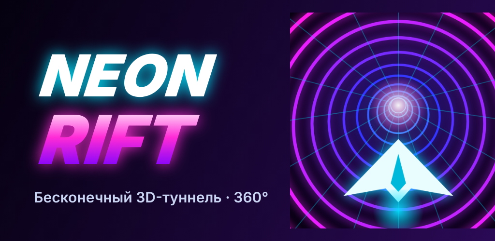

# NEON RIFT

3D-раннер для Android и браузера. Корабль летит по бесконечному неоновому туннелю, и вы вращаете его по стенке на все 360°. Нужно уворачиваться от стен, перепрыгивать барьеры, собирать кристаллы и подбирать бонусы.



## Как играть

| Действие | Телефон | Клавиатура |
|---|---|---|
| Вращаться по туннелю | вести пальцем влево и вправо (или наклонять телефон, режим «Наклон») | ← → / A D |
| Прыжок | тап, свайп вверх или второй палец | Пробел / ↑ / W |
| Резкое приземление | свайп вниз в прыжке | ↓ / S |
| Пауза | кнопка ⏸ или «Назад» | Esc / P |

- **Красные/розовые стены** высокие, их нужно облетать.
- **Жёлтые/голубые барьеры** низкие, их нужно перепрыгивать (цвет меняется в каждом мире).
- **Пролёт на волоске** даёт бонусные очки и поднимает множитель комбо (до x8).
- **Золотое кольцо «РЕКОРД»** в туннеле отмечает ваш лучший забег.

## Что есть в игре

- Процедурный туннель с 10 типами препятствий: блоки, барьеры, стены с проходом, вращающиеся лопасти, слайдеры, слалом, коридоры, поля препятствий, двойные ловушки. Сложность и скорость растут постепенно.
- 6 миров со своей палитрой (Неоновый город, Магматическое ядро, Ледяная пустота, Токсичный сектор, Закат синтвейва, Сердце разлома). Мир меняется каждые 900 м.
- **Босс «Страж разлома»** в середине каждого мира: гигантский глаз в центре туннеля стреляет стенами, кольцами, лопастями и ловушками. Чтобы его ранить, собирайте белые ядра ✦. С каждым разом у него больше здоровья и новые атаки, а награда растёт.
- **Случайные события в забеге**: кристальный дождь, тьма (видимость падает, очки x2) и вихрь (туннель закручивает корабль).
- **Испытание дня**: одна трасса на всех в течение дня, свой рекорд и +150 кристаллов за первые 1000 м.
- 4 бонуса: щит, магнит, форсаж (ломает стены) и двойные очки.
- Ангар: 6 кораблей с разными корпусами (один с радужным переливом) и 3D-просмотр.
- Улучшения: у каждого бонуса 5 уровней длительности.
- Задания: всегда 3 активных, со временем усложняются и дают больше кристаллов.
- Ежедневная награда с 7-дневной серией.
- Таблица 10 лучших забегов и общая статистика.
- Обучение при первом запуске.
- Возрождение за кристаллы, один раз за забег.
- Музыка и звуки синтезируются в реальном времени (синтвейв на WebAudio), файлов со звуком нет.
- Неоновое свечение (bloom), частицы, шлейф, тряска камеры, слоу-мо при крушении.
- Настройки: громкость, чувствительность, свайп или наклон, качество графики (с автоподстройкой под FPS), вибрация, язык RU/EN.
- Работает офлайн: в APK всё лежит локально, веб-версия ставится как PWA.

## Файлы

```
neon-rift/
  src/           исходники игры (Three.js, ES-модули)
    main.js      игровой цикл, физика, камера, экономика, состояния
    world.js     туннель (шейдер), генератор препятствий, кристаллы, бонусы
    player.js    модели кораблей, шлейф, щит
    audio.js     процедурная музыка и SFX, офлайн-рендер для трейлера
    events.js    босс «Страж разлома» и случайные события
    bot.js       автопилот (фон меню и запись трейлера)
    ui.js, input.js, i18n.js, storage.js, config.js, fx.js
  public/        index.html, стили, PWA-манифест, service worker, иконки
  www/           готовая веб-сборка (её открывают в браузере и кладут в APK)
  android/       Android-проект (WebView-обёртка, Gradle)
  dist/          готовый NeonRift.apk
  promo/         трейлер, иконка, обложка, скриншоты, текст для Google Play
  tools/         сборка APK без Gradle, генерация иконок
```

## Сборка

```bash
npm install
node build.mjs            # собирает www/
```

**APK без Android Studio** (Ubuntu/Debian):

```bash
sudo apt install aapt dalvik-exchange zipalign apksigner android-sdk-platform-23
./tools/build-apk.sh      # создаёт dist/NeonRift.apk
```

**APK через Gradle**: GitHub Actions (`.github/workflows/neon-rift-android.yml`) собирает его при каждом пуше в `neon-rift/`. Готовый файл лежит в артефактах запуска. Локально:

```bash
cp -r www android/app/src/main/assets/www
cd android && gradle assembleRelease
```

Для публикации в Google Play задайте свой ключ через переменные `NR_KEYSTORE`, `NR_KEYSTORE_PASSWORD`, `NR_KEY_ALIAS`, `NR_KEY_PASSWORD`.

## Установка на телефон

1. Скачайте `dist/NeonRift.apk` на Android 7.0 или новее.
2. Откройте файл и разрешите установку из этого источника.
3. Запустите **NEON RIFT**.
