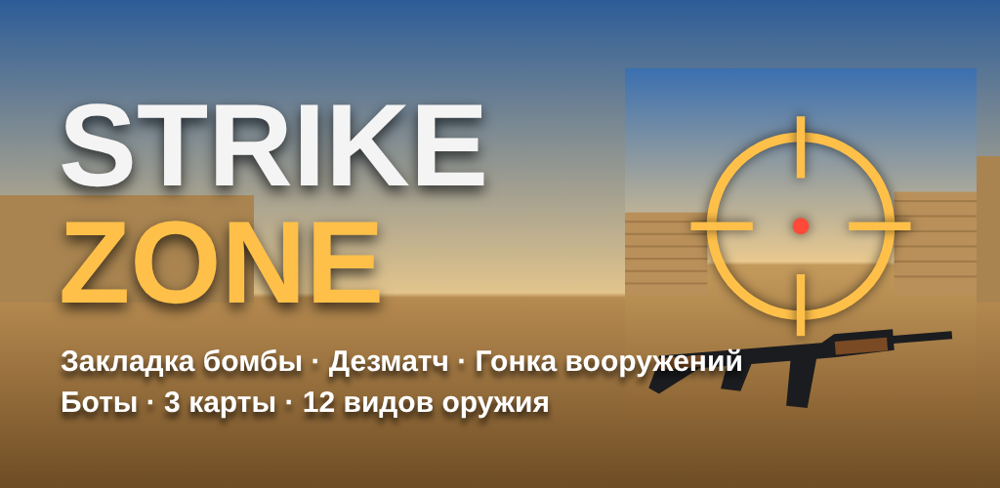

# STRIKE ZONE

Тактический 3D-шутер для Android и браузера в духе классических командных шутеров начала 2000-х. Террористы закладывают бомбу, спецназ её защищает. Есть закупка оружия, экономика раундов, отдача и разброс, броня, гранаты и боты с разной сложностью.



## Режимы

- **Закладка бомбы.** Командные раунды. Террористы закладывают C4 на точке A или B, спецназ не даёт её заложить или обезвреживает. Побеждает команда, которая первой наберёт нужное число раундов (3, 5, 8, 10 или 16).
- **Дезматч.** Командный бой с мгновенным возрождением и бесплатным выбором оружия. Играется до 40 убийств или 10 минут.
- **Гонка вооружений.** Каждый сам за себя. Каждое убийство даёт следующее оружие (13 ступеней). Побеждает тот, кто первым убьёт ножом на последней ступени. Если вас убили ножом, вы теряете ступень.

## Карты

| Карта | Описание | Режимы |
|---|---|---|
| Пески | Пустынный городок: длинная к A, мид с дверями, туннели к B, мостик | все |
| Склад | Портовый склад со стеллажами, контейнерами и платформой спецназа | все |
| Арена | Компактная ночная арена с центральной платформой | дезматч, гонка |

## Что есть в игре

- **Оружие (12 видов):** нож, Glock-18, USP, Desert Eagle, M3, MP5, P90, Galil, FAMAS, AK-47, M4A1, Scout, AWP. Плюс осколочная, световая и дымовая гранаты, бронежилет, шлем, набор сапёра и C4.
- **Стрельба как в классике:** у каждого оружия свои урон, скорострельность, падение урона с дистанцией, пробитие брони, магазин и время перезарядки. Разброс растёт на бегу и в прыжке и уменьшается сидя. Очередь уводит прицел вверх, потом в стороны. Попадание в голову даёт урон ×4, в ноги ×0.75.
- **Прострел:** винтовки, снайперки и Desert Eagle пробивают ящики, бочки и низкие стены с потерей урона. AWP прошивает несколько противников.
- **Снайперские прицелы** с двумя кратностями. После выстрела AWP передёргивается затвор.
- **Нож:** быстрый удар и мощный укол. Удар в спину почти всегда смертелен.
- **Гранаты:** отскакивают от стен и пола. Осколочная ранит с учётом укрытий. Световая ослепляет тех, кто смотрит на вспышку. Дымовая создаёт облако на 18 секунд, через которое не видят ни игроки, ни боты.
- **Экономика:** $800 на старте, $300 за убийство, $3250/$3500 за победу, растущий бонус за поражения ($1400–3400), $800 террористам за закладку, максимум $16000. Закупка в зоне возрождения в первые 25 секунд раунда. Есть кнопки «Повторить» и «Автозакупка».
- **Подбор оружия:** убитые роняют оружие и бомбу. Пустой слот заполняется, если пройти по оружию, а кнопка «Действие» меняет текущее оружие на лежащее.
- **Боты:** видят только по прямой видимости в своём поле зрения, не видят сквозь дым, слепнут от световых, слышат шаги и выстрелы. У них есть время реакции и ошибка прицела, они контролируют отдачу, стреляют очередями, стрейфятся и приседают. Террористы идут на точку всей командой, кидают дым и световые, закладывают бомбу и охраняют её. Спецназ распределяется по точкам, сторожит проходы, перебрасывается на помощь и обезвреживает бомбу. Боты сами закупаются и экономят. Сложность: лёгкие, нормальные, сложные, эксперты.
- **Интерфейс:** вращающийся радар (союзники, замеченные враги, бомба), лента убийств с отметками хедшотов и прострелов, таблица счёта, радиосообщения, индикаторы направления урона, маркер попадания, динамический прицел, полоса закладки и разминирования, зрители после смерти (касание огня переключает игрока), лучший игрок раунда, итоги матча.
- **Звук:** весь звук синтезируется на лету. Выстрелы у каждого оружия свои, есть 3D-позиционирование шагов и выстрелов, писк бомбы ускоряется, после световой звенит в ушах. Голос радио работает через синтез речи, если устройство его поддерживает.
- **Управление на телефоне:** плавающий джойстик слева, обзор свайпом справа. Кнопку огня можно вести пальцем, чтобы целиться во время стрельбы. Есть вторая кнопка огня слева, прыжок, присед, перезарядка, прицел, контекстная кнопка «Действие» и выбор оружия касанием. Помощь в прицеливании и автоогонь по цели включаются в настройках.
- **ПК и геймпад:** WASD и мышь с захватом курсора, все клавиши как в классике (R, E, G, B, Q, 1–5, Tab, Shift, Ctrl). Геймпад тоже поддерживается.
- **Настройки:** язык RU/EN, громкость, голос радио, чувствительность экрана и мыши, поле зрения, графика (авто, низкая, средняя, высокая) с автоподстройкой под FPS, размер и прозрачность кнопок, цвет прицела, инверсия, вибрация, счётчик FPS.
- **Статистика:** убийства, смерти, У/С, процент хедшотов, точность, победы, MVP, закладки, разминирования, время в игре.

## Как играть

| Действие | Телефон | ПК |
|---|---|---|
| Движение | джойстик слева | WASD |
| Обзор | свайп справа | мышь |
| Огонь | кнопка ● (можно вести пальцем) | ЛКМ |
| Прицел / укол ножом | ⊕ | ПКМ |
| Прыжок / присесть | ⤒ / ⤓ | Пробел / Ctrl |
| Тихий шаг | джойстик не до упора | Shift |
| Перезарядка | ↻ | R |
| Заложить, обезвредить, подобрать | ✋ (появляется, когда можно) | E (удерживать) |
| Оружие | касание слота внизу | 1–5, колесо, Q |
| Бросить оружие | ⇣ | G |
| Закупка / счёт / пауза | $ / ☰ / ❚❚ | B / Tab / Esc |

## Файлы

```
strike-zone/
  src/
    main.js       рендер, камера, вид от первого лица, ввод, меню, цикл
    game.js       матч: раунды, экономика, бомба, возрождение, подбор оружия, режимы
    combat.js     стрельба, разброс и отдача, хитбоксы, прострел, нож, гранаты
    bot.js        ИИ ботов: восприятие, прицеливание, навигация, тактика, закупка
    grid.js       логика мира: карта-heightfield, коллизии, лучи, поиск пути A*
    actor.js      игрок/бот: здоровье, броня, инвентарь
    maps.js       карты (прямоугольники на сетке 2 м) и темы освещения
    worldmesh.js  построение геометрии карты, свет, небо
    models.js     модели персонажей, оружия и рук
    fx.js         частицы, следы пуль, кровь, трассеры, дым
    audio.js      синтез звука, 3D-звук, голос радио
    ui.js         меню, HUD, закупка, счёт, радар
    config.js, rules.js, input.js, i18n.js, storage.js, textures.js
  public/         index.html, стили, PWA-манифест, service worker, иконки
  www/            готовая веб-сборка (её открывают в браузере и кладут в APK)
  android/        Android-проект (WebView-обёртка, Gradle)
  dist/           готовый StrikeZone.apk
  promo/          иконка и обложка для магазина
  tests/          юнит-тесты логики и браузерные тесты с ботами
  tools/          сборка APK без Gradle, генерация иконок
```

## Сборка и тесты

```bash
npm install
npm run build          # собирает www/
npm test               # юнит-тесты: карты, коллизии, лучи, пути, броня, экономика
npm run test:e2e       # браузерные тесты (нужен Playwright): меню, HUD, касания, матчи ботов во всех режимах
```

**APK без Android Studio** (Ubuntu/Debian):

```bash
sudo apt install aapt dalvik-exchange zipalign apksigner android-sdk-platform-23
./tools/build-apk.sh   # создаёт dist/StrikeZone.apk
```

**APK через Gradle:** GitHub Actions (`.github/workflows/strike-zone-android.yml`) собирает его при каждом пуше в `strike-zone/`. Локально:

```bash
cp -r www android/app/src/main/assets/www
cd android && gradle assembleRelease
```

Для публикации в Google Play задайте свой ключ через переменные `SZ_KEYSTORE`, `SZ_KEYSTORE_PASSWORD`, `SZ_KEY_ALIAS`, `SZ_KEY_PASSWORD`.

## Установка на телефон

1. Скачайте `dist/StrikeZone.apk` на телефон.
2. Разрешите установку из этого источника, когда Android спросит.
3. Откройте STRIKE ZONE. Игра работает без интернета и в горизонтальной ориентации.

Веб-версия открывается в браузере по ссылке `strike-zone/www/index.html` на GitHub Pages и ставится на главный экран как приложение.
